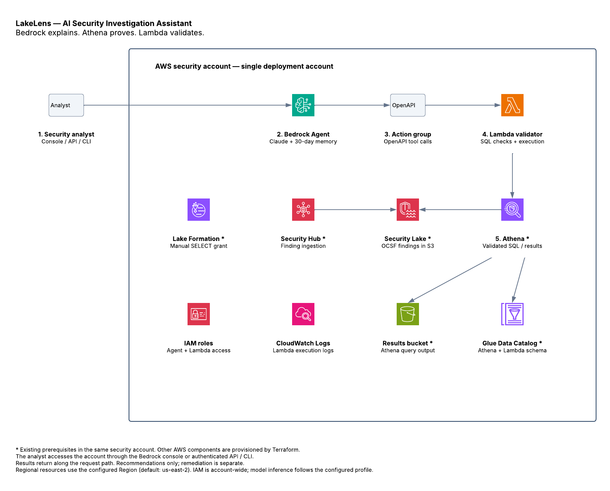

# LakeLens: Security Investigations with Amazon Bedrock and Amazon Security Lake

**Ask your security data. Investigate with evidence.**

LakeLens is an AI security investigation assistant built with Amazon Bedrock and Amazon Security Lake, deployed with Terraform. Security analysts can ask natural language questions about Security Hub findings (stored in OCSF-normalized Security Lake tables), receive validated Athena query results, and get AI-generated summaries with MITRE ATT&CK mappings and recommended controls.

**Core Design Principle:** "Bedrock explains. Athena proves. Lambda validates. Corrective controls enforce separately."

## Architecture Overview

[](https://lucid.app/lucidchart/c6b47454-b3ee-4bf3-bc1d-14e1807d0482/edit)

[Open the editable architecture diagram in Lucid](https://lucid.app/lucidchart/c6b47454-b3ee-4bf3-bc1d-14e1807d0482/edit). The image above is a static PNG exported from Lucid; re-export it after changing the diagram.

Arrows show the investigation and data paths. Results return along the request path. Components marked with an asterisk are existing prerequisites; IAM roles, Lake Formation permissions, and CloudWatch logging are shown as supporting controls. Terraform creates the Bedrock Agent and alias, OpenAPI action group, Lambda validator/executor, IAM roles, and CloudWatch log group. Query results return through Lambda and the action group to Bedrock for the analyst's summary.

**Account boundary:** All AWS components shown belong to one security account. The analyst uses an authenticated console or API/CLI client outside that boundary. Terraform uses one AWS provider and the current caller account for Athena and Glue permissions; this deployment does not configure cross-account role assumption or data sharing. Regional resources use `aws_region` (default: `us-east-2`); IAM is account-wide, and model inference follows the configured Bedrock inference profile.

**Deployment boundary:** The knowledge base, OpenSearch Serverless, and knowledge base S3 modules are not wired into `main.tf` and are excluded from the active architecture. The agent recommends controls; remediation is performed separately. Lake Formation SELECT access for the Lambda role is granted manually. The existing Athena workgroup must configure its query results output location.

### Request Flow

1. Analyst asks a natural language question via the Bedrock Agent
2. Agent formulates an SQL query using its knowledge of OCSF schema
3. Agent invokes the Action Group (Lambda)
4. Lambda validates the SQL through an 8-step pipeline (statement safety + scope constraints)
5. On pass: Lambda executes query via Athena, formats results, returns structured JSON
6. On fail: Lambda returns structured error with specific validation failures
7. Agent summarizes results, maps to MITRE ATT&CK, and recommends 1-3 controls (detective/corrective/preventative)

### What's Included

```text
.
├── main.tf                          # Root module orchestration
├── variables.tf                     # All input variables (all have defaults)
├── outputs.tf                       # Module outputs
├── providers.tf                     # AWS provider config
├── versions.tf                      # Terraform/provider constraints
├── terraform.tfvars.example         # Example variable values
├── scripts/
│   └── deploy_agent.sh             # Deploy script (apply + prepare + version)
├── docs/
│   ├── analyst-guide.md            # How to use the agent (for analysts)
│   └── test-prompts.md             # 28 test prompts across 8 categories
└── modules/
    ├── iam/                         # Bedrock Agent + Lambda roles
    ├── athena_query_lambda/         # Lambda function (SQL validator + executor)
    └── bedrock_agent/               # Agent, alias, action group, memory
```

## Prerequisites

Before deploying, ensure the following exist in your AWS account:

- **AWS Security Lake** enabled with Security Hub as a log source
- **Security Hub** enabled and collecting findings
- **Glue Data Catalog** table: `amazon_security_lake_table_us_east_2_sh_findings_2_0`
- **Athena Workgroup** (default: `primary`) configured and operational
- **Athena Results S3 Bucket** for query output storage
- **Anthropic Claude model access** enabled in Bedrock (quota must be > 0)
- **Lake Formation SELECT grant** on the Security Lake table for the Lambda role (done post-deploy)

## Input Variables

All variables have defaults. You can deploy with zero configuration for a POC in us-east-2.

| Variable | Type | Default | Description |
| -------- | ---- | ------- | ----------- |
| `aws_region` | `string` | `"us-east-2"` | AWS region |
| `environment` | `string` | `"dev"` | Environment identifier |
| `name_prefix` | `string` | `"security-lake-bedrock"` | Resource naming prefix |
| `bedrock_foundation_model_id` | `string` | Claude Sonnet 4.6 inference profile ARN | Foundation model for the agent |
| `security_lake_database_names` | `list(string)` | `["amazon_security_lake_glue_db_us_east_2"]` | Glue databases the agent can query |
| `allowed_security_lake_tables` | `list(string)` | `["amazon_security_lake_table_us_east_2_sh_findings_2_0"]` | Tables the agent can query |
| `allowed_security_lake_table_prefixes` | `list(string)` | `[]` | Table name prefixes allowed |
| `athena_workgroup_name` | `string` | `"primary"` | Existing Athena workgroup |
| `athena_output_bucket_name` | `string` | `"athena-query-results-..."` | Existing Athena results bucket |
| `max_query_limit` | `number` | `1000` | Max LIMIT value (1-10000) |
| `max_lookback_days` | `number` | `90` | Max time range in days (1-365) |
| `query_timeout_seconds` | `number` | `300` | Athena timeout in seconds (1-900) |
| `log_retention_days` | `number` | `90` | CloudWatch Logs retention |
| `tags` | `map(string)` | `{}` | Tags for all resources |

## Deployment

### 1. Initialize and Apply

```bash
terraform init
terraform apply
```

The first apply may partially fail if Bedrock needs to prepare the agent. Just run `terraform apply` again.

### 2. Grant Lake Formation Permissions

The Lambda role needs SELECT access to the Security Lake table. This must be done outside Terraform:

```bash
aws lakeformation grant-permissions \
  --principal DataLakePrincipalIdentifier="arn:aws:iam::748355717020:role/security-lake-bedrock-lambda-executor-dev" \
  --resource '{"Table":{"DatabaseName":"amazon_security_lake_glue_db_us_east_2","Name":"amazon_security_lake_table_us_east_2_sh_findings_2_0"}}' \
  --permissions '["SELECT"]' \
  --permissions-with-grant-option '[]' \
  --region us-east-2
```

### 3. Test the Agent

Use the Bedrock Agent console test window, or via CLI:

```bash
aws bedrock-agent-runtime invoke-agent \
  --agent-id "$(terraform output -raw bedrock_agent_id)" \
  --agent-alias-id TSTALIASID \
  --session-id "test-$(date +%s)" \
  --input-text "Show me 3 findings from the last day"
```

See `docs/test-prompts.md` for 28 additional test prompts.

## Agent Capabilities

The agent can:

- Query Security Hub findings stored in Security Lake (OCSF format)
- Aggregate, filter, and summarize finding data
- Map findings to **MITRE ATT&CK** techniques (ID, name, tactic)
- Recommend 1-3 controls per finding (detective / corrective / preventative)
- Name specific AWS services for each control recommendation
- Reference CIS, NIST 800-53, and AWS Well-Architected best practices
- Remember past conversations (SESSION_SUMMARY memory, 30 days retention)

The agent **cannot**:

- Remediate findings or modify any AWS resources
- Access tables outside the approved list
- Query data older than the configured lookback window (default: 90 days)
- Return more than 1000 rows in a single query
- Execute destructive SQL operations
- Browse the internet or access external data sources

## Security Guardrails

### SQL Validation Pipeline (8 steps)

1. **Parse & Classify** — Only SELECT and CTE+SELECT accepted
2. **Statement Safety** — Forbidden keywords rejected (DROP, DELETE, INSERT, UPDATE, ALTER, CREATE, MERGE, TRUNCATE, UNLOAD, MSCK, CTAS)
3. **Table Extraction** — All referenced tables identified
4. **Database Validation** — Only approved Glue databases allowed
5. **Table Validation** — Only approved tables or prefix-matching tables allowed
6. **Limit Check** — Non-aggregate queries require LIMIT (1 to max_query_limit)
7. **Time Filter Check** — Must filter on `time_dt` or `time`
8. **Lookback Check** — Time range cannot exceed max_lookback_days

### Read-Only by Design

- Lambda IAM role: Athena query execution, S3 results read/write, Glue catalog read, CloudWatch Logs write. **Nothing else.**
- Agent instructions explicitly state: no remediation, recommend only
- OpenAPI schema: only read/explain operations defined
- No SQL comments allowed (injection prevention)
- Fail closed on any parse error

## Outputs

| Output | Description |
| ------ | ----------- |
| `bedrock_agent_id` | The ID of the Bedrock Agent |
| `bedrock_agent_arn` | The ARN of the Bedrock Agent |
| `bedrock_agent_alias_id` | The ID of the Bedrock Agent alias |
| `lambda_function_name` | The name of the Lambda validator function |
| `lambda_function_arn` | The ARN of the Lambda validator function |
| `athena_output_bucket_name` | The Athena results S3 bucket (pass-through) |

## Known Limitations

| Limitation | Details |
| ---------- | ------- |
| Query timeout | Default 300s. Security Lake Iceberg tables can be slow on first query (cold metadata). |
| No Knowledge Base | KB module exists but is not wired in. Agent relies on Claude's training data for OCSF/MITRE knowledge. |
| Lake Formation grants | Must be configured manually outside Terraform after deployment. |
| Alias versioning | The TSTALIASID (test alias) always points to DRAFT. For production, use the deploy script. |
| Single region | Queries target one region's Security Lake tables only. |
| Anthropic quota | Your account must have Anthropic Claude quota > 0 (request via Service Quotas). |

## Future Enhancements

- **Knowledge Base** — Wire in the existing KB module with OpenSearch Serverless for RAG-based OCSF context
- **Multi-region** — Federate queries across Security Lake tables in multiple regions
- **Additional data sources** — CloudTrail, VPC Flow Logs, Route53 via Security Lake
- **Automated remediation pipeline** — Step Functions consuming agent recommendations with approval gates
- **Scheduled reporting** — Periodic security posture summaries via EventBridge + SNS

## Requirements

| Name | Version |
| ---- | ------- |
| Terraform | >= 1.5.0 |
| AWS Provider | >= 5.0.0, < 6.0.0 |
| Archive Provider | >= 2.0.0, < 3.0.0 |

## License

LakeLens is licensed under the [MIT License](LICENSE).
